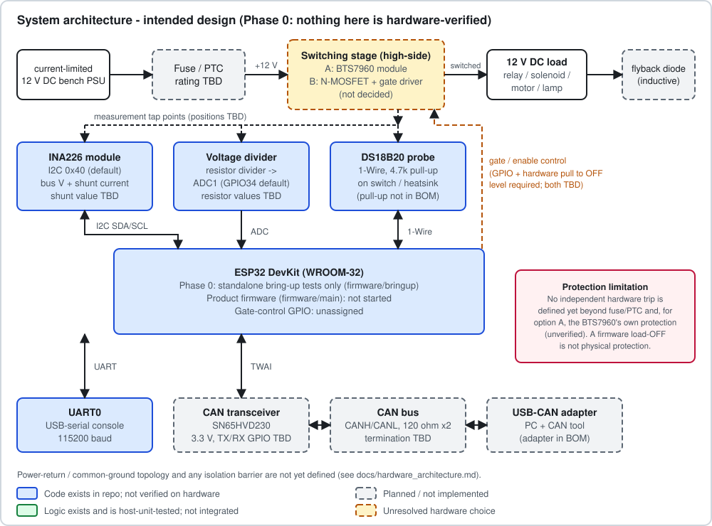
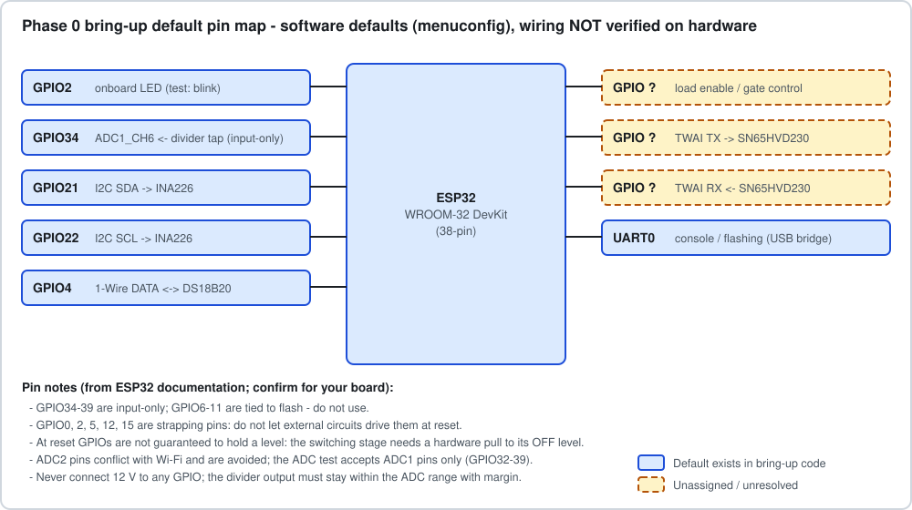
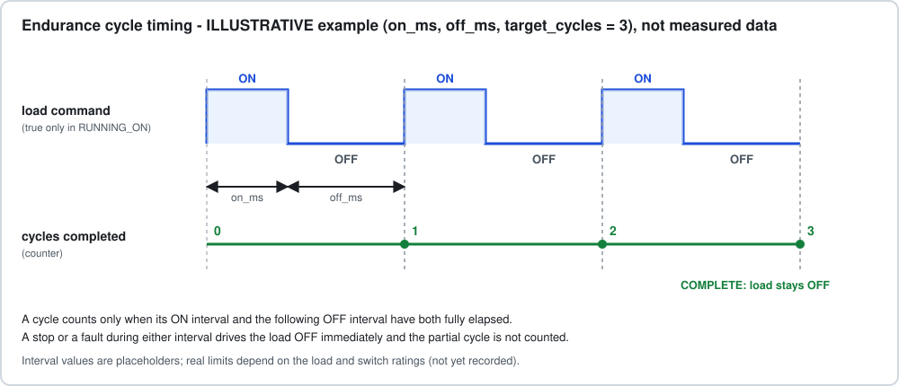

# Automated Electrical Load Endurance & Fault-Diagnostic Test Controller

An ESP32 / ESP-IDF / FreeRTOS project for a **single-channel endurance tester for low-voltage
12 V DC loads** (relays, solenoids, small motors, lamps): switch a load ON/OFF for a set
number of cycles while monitoring voltage, current and temperature, detect faults, and report
over UART and CAN.

> **Status: Phase 0 (hardware bring-up).** The product firmware, switching hardware, fault
> detection, CAN and NVS persistence are **not built yet**. What exists is standalone
> bring-up code (never built or run on hardware), a host-tested endurance-scheduler core, a
> serial capture tool, and the design documentation. Nothing has been verified on hardware.
> Details: [traceability matrix](docs/traceability.md) · [audit](docs/audit.md).



*Intended design. Blue = code exists, not hardware-verified; grey dashed = planned; amber
dashed = unresolved hardware choice.*

## Scope and honesty statement

Educational/portfolio architecture at **student bench scale**: 12 V DC, current-limited
supply, **no mains switching**. It is not automotive-grade, not production-qualified, and
makes no ISO 26262 or other functional-safety claim. Measurements will describe one bench
setup, not certified accuracy. A firmware load-OFF is not a substitute for independent
hardware protection ([safety](docs/safety.md)).

## Problem and intended application

Endurance-testing a relay, solenoid or lamp means thousands of switching cycles with a
repeatable profile, a cycle count that survives resets, and early detection of a load or
switch going bad. The intended controller runs a programmable ON/OFF profile, samples load
voltage, load current and switch temperature, classifies faults, drops the load to a safe
state, and logs evidence.

## What works today / what is planned

| Implemented (software only, not hardware-verified) | Planned | Known limitations |
|---|---|---|
| Phase 0 bring-up tests: blink + UART ping, ADC read, INA226 ID + bus voltage, DS18B20 read - **written, not yet built or run** | Switching hardware and gate/enable drive | No switching stage, schematic or verified wiring |
| `firmware/core`: profile validation, endurance state machine, cycle counting, fault latch, debounce - **host-unit-tested** (97 checks) | Fault detection with thresholds and debounce | Thresholds, reaction-time budget, transient/hard rules undefined |
| `tools/bringup_capture.py`: serial capture to JSON lines with optional reference check - **unit-tested offline** | NVS persistence, UART command set | Cycle count is not persisted |
| Documentation, requirements traceability, diagrams | Watchdog supervision, FreeRTOS tasks | No tasks, no watchdog use |
| | CAN/TWAI telemetry (draft protocol only) | No CAN code or wiring; IDs unconfirmed |

Not built or run: **no ESP-IDF/PlatformIO build of this code has succeeded** (the toolchain
could not be installed in the audit environment). Treat the bring-up firmware as
unverified until a build is recorded in the [validation report](docs/validation_report.md).

## Intended fault categories

| Fault | Status |
|---|---|
| Overcurrent | Not implemented (debounce helper unit-tested; thresholds TBD) |
| Short circuit | Not implemented; **needs independent hardware protection**, software sampling is too slow |
| Open load | Not implemented |
| Overtemperature | Not implemented (sensor reads switch/heatsink temperature, not junction) |
| Undervoltage | Not implemented (sag-vs-undervoltage rule TBD) |

Specification skeleton: [docs/fault_policy.md](docs/fault_policy.md).


## Firmware architecture and environment

Target: ESP32 DevKit (WROOM-32), C, ESP-IDF **>= 5.2** (inside PlatformIO's `espidf`
framework or standalone). Proposed modules and task model, clearly marked as not
implemented: [docs/firmware_architecture.md](docs/firmware_architecture.md). The endurance
logic is separated into hardware-independent code so it can be tested on a PC:


```
firmware/bringup/   Phase 0 standalone hardware tests (not the product firmware)
firmware/core/      host-tested scheduler + debounce (not yet integrated)
firmware/main/      product firmware: not started
docs/               requirements, traceability, architecture, fault policy, CAN, safety, guides
hardware/           BOM and schematic notes (no schematic yet)
tools/              serial capture tool
tests/              unit tests (C), Python tests, fault-injection log area (empty)
assets/diagrams/    SVG diagrams + generator
```

## Hardware (see [hardware architecture](docs/hardware_architecture.md))

| Item | Role | Decision state |
|---|---|---|
| ESP32 DevKit (WROOM-32) | Controller | Selected |
| BTS7960 module **or** N-MOSFET + gate driver | Load switch | **Open** |
| INA226 module (I2C) | Current + bus voltage | Selected; shunt value unrecorded |
| Resistor divider -> ESP32 ADC1 | Load/supply voltage | Topology only; values unrecorded |
| DS18B20 probe (1-Wire) | Switch/heatsink temperature | Selected (only temperature sensor in BOM/code; no NTC) |
| SN65HVD230 module | CAN transceiver | Selected; pins/termination open |
| Fuse/PTC, flyback diode/TVS | Protection | Ratings open |
| 12 V current-limited bench PSU, relay/motor/lamp test loads | Power and loads | Selected |

Bill of materials with price ranges: [hardware/bom.csv](hardware/bom.csv). Bring-up default
pins (software defaults, not verified wiring):



## Build and bring-up

Full guide: [docs/setup.md](docs/setup.md). Pick one bring-up test at a time
(`BLINK`, `ADC_READ`, `I2C_INA226`, `DS18B20`) in menuconfig; only the selected test is compiled.

**PlatformIO (recommended)**

```bash
cd firmware/bringup
pio run -t menuconfig   # "Bring-up Test Selection (Phase 0)"
pio run
pio run -t upload
pio device monitor      # 115200 baud
```

**ESP-IDF >= 5.2**

```bash
cd firmware/bringup
idf.py set-target esp32
idf.py menuconfig       # "Bring-up Test Selection (Phase 0)"
idf.py build flash monitor
```

Set the real divider resistor values in menuconfig for the ADC test (defaults are
examples) and never connect 12 V to a GPIO. Serial problems and common failures:
[docs/troubleshooting.md](docs/troubleshooting.md).

Optional capture of a bring-up run to a JSON-lines log:

```bash
pip install -r tools/requirements.txt
mkdir -p tests/bringup_logs
python3 tools/bringup_capture.py --test ds18b20 --port /dev/ttyUSB0 --duration 20 \
    --reference 23.5 --tolerance 2.0 --out tests/bringup_logs/ds18b20.jsonl
```

## Running the automated tests

```bash
make -C tests/unit                                  # scheduler/debounce core (C, host)
make -C tests/unit san                              # + AddressSanitizer/UBSan
python3 -m unittest discover -s tests/python -v     # capture tool
```

These are software tests (some on synthetic fixtures); they do not verify switching,
sensing accuracy or fault reaction time. See [docs/testing.md](docs/testing.md).

## Validation status

No bench measurement, build log or endurance run exists. The [validation report](docs/validation_report.md)
records only the host-side checks that were actually run and keeps the measurement tables
empty until real data exists. Measurements will be recorded with `tools/bringup_capture.py`
logs and the record format in [tests/fault_injection_log](tests/fault_injection_log/README.md).



## Documentation

[Requirements](docs/requirements.md) · [Traceability](docs/traceability.md) ·
[Audit](docs/audit.md) · [Hardware architecture](docs/hardware_architecture.md) ·
[Firmware architecture](docs/firmware_architecture.md) · [State machine](docs/state_machine.md) ·
[Fault policy](docs/fault_policy.md) · [CAN protocol (draft)](docs/can_protocol.md) ·
[Safety](docs/safety.md) · [Setup](docs/setup.md) · [Testing](docs/testing.md) ·
[Troubleshooting](docs/troubleshooting.md) · [Roadmap](docs/roadmap.md) ·
[Validation report](docs/validation_report.md)

## Known limitations and next steps

* Nothing is verified on hardware; the bring-up code has not been compiled by an ESP32 toolchain.
* Open decisions: switching stage, isolation/grounding (SR9), independent hardware overcurrent
  trip, protection ratings, shunt/divider values, CAN parameters.
* Next: finish Phase 0 gates, record the first build and sensor readings, then Phase 1 hardware
  ([roadmap](docs/roadmap.md)).

## References

Documents to consult; datasheet values quoted in this repository come from memory and
should be re-checked against the manufacturer's current datasheet.

* ESP-IDF Programming Guide (ADC oneshot/calibration, I2C master, TWAI, console): https://docs.espressif.com/projects/esp-idf/
* PlatformIO `espidf` framework: https://docs.platformio.org/
* TI INA226 datasheet: https://www.ti.com/product/INA226
* TI SN65HVD230 datasheet: https://www.ti.com/product/SN65HVD230
* Analog Devices / Maxim DS18B20 datasheet: https://www.analog.com/en/products/ds18b20.html
* Infineon BTS7960 datasheet (find on infineon.com)

## License

**Undecided.** No license file exists, so default copyright applies: no reuse licence is
granted until the author chooses one.

## Author

[yash-mehta13](https://github.com/yash-mehta13)
