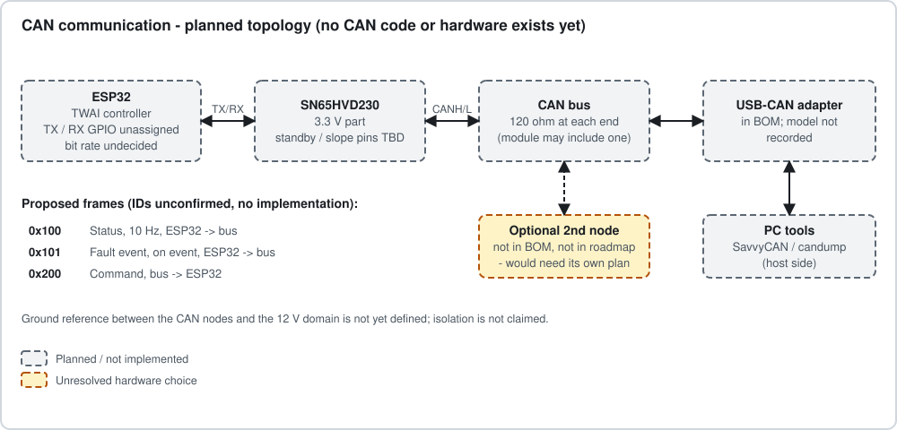

# CAN Protocol

## Status

* **Nothing is implemented or verified.** No TWAI code, no wiring, no bus capture exists.
* **Topology:** the only configuration implied by the repository is ESP32 + SN65HVD230 ->
  CAN bus -> USB-CAN adapter (BOM item) -> PC tool. An ESP32-to-STM32 or other second node is
  **not** in the BOM or roadmap; it is shown on the diagram only as an unplanned option.
* **Unresolved:** TX/RX GPIOs, bit rate, termination (and whether the transceiver module
  already includes it), adapter model, ground/isolation arrangement between nodes.
* The IDs in the original planned-frame table (0x100 status, 0x101 fault event, 0x200
  command) are **unconfirmed**; no implementation exists to check them against.

## Draft frame layout (PROPOSED v0 - subject to change)

Intended as a starting point for Phase 6; **do not treat it as the actual protocol.** Standard
11-bit identifiers, DLC 8, little-endian, unused bytes sent as 0. No DBC file is provided
because a DBC would present an unimplemented interface as real; generate one once the
firmware sends these frames.

The original table packed state, count and all measurements into one 0x100 frame. Eight
bytes cannot hold a 32-bit cycle count plus three measurements, so the draft splits them.

### 0x100 Status - ESP32 -> bus, 10 Hz (proposed)

| Byte | Field | Type | Unit / values |
|---|---|---|---|
| 0 | `state` | u8 | 0 BOOT, 1 IDLE, 2 RUNNING_ON, 3 RUNNING_OFF, 4 COMPLETE, 5 FAULT |
| 1 | `fault_code` | u8 | 0 none; otherwise as [fault_policy.md](fault_policy.md) (provisional) |
| 2-5 | `cycles_completed` | u32 | cycles |
| 6 | `alive` | u8 | increments every frame (wraps) |
| 7 | reserved | u8 | 0 |

### 0x102 Measurements - ESP32 -> bus, 10 Hz (proposed)

| Byte | Field | Type | Scaling |
|---|---|---|---|
| 0-1 | `load_voltage_mv` | u16 | 1 mV |
| 2-3 | `load_current_ma` | i16 | 1 mA (+/-32.767 A range; real range limited by the shunt) |
| 4-5 | `temperature_decic` | i16 | 0.1 C |
| 6 | `valid` | u8 | bit0 voltage valid, bit1 current valid, bit2 temperature valid |
| 7 | reserved | u8 | 0 |

Values flagged invalid must be ignored by receivers.

### 0x101 Fault event - ESP32 -> bus, event-triggered (proposed)

Sent on entry to FAULT and repeated at 1 Hz while latched so late listeners see it.

| Byte | Field | Type | Meaning |
|---|---|---|---|
| 0 | `fault_code` | u8 | as above |
| 1 | `state_at_fault` | u8 | state before the fault |
| 2-5 | `cycles_completed` | u32 | cycles completed when latched |
| 6-7 | `value` | i16 | measurement that tripped the rule; unit by fault: mA (current), 0.1 C (temperature), mV (voltage) |

### 0x200 Command - bus -> ESP32 (proposed)

| Byte | Field | Type | Meaning |
|---|---|---|---|
| 0 | `command` | u8 | 2 = STOP. **START and CLEAR_FAULT are UART-only in this draft** until an authorization decision is made |
| 1 | `sequence` | u8 | incremented by sender |
| 2-7 | reserved | - | 0 |

Receivers must ignore frames with unexpected DLC or unknown command values and must never let
CAN activity (or its absence) block the control task. Loss of the bus is a reporting problem,
not a reason to keep the load energized or to stop a safe shutdown.

## Behaviour requirements for the implementation

* TWAI bus-off: recover automatically, count and report occurrences; never block control.
* Timeout guidance for hosts: treat a missing status frame for > 3 periods (300 ms) as lost.
* Bit rate must be identical on every node; 500 kbit/s is common but **not chosen**.
* Verify with an adapter and a capture tool; record the capture under `tests/` and update
  [traceability.md](traceability.md) only then.
