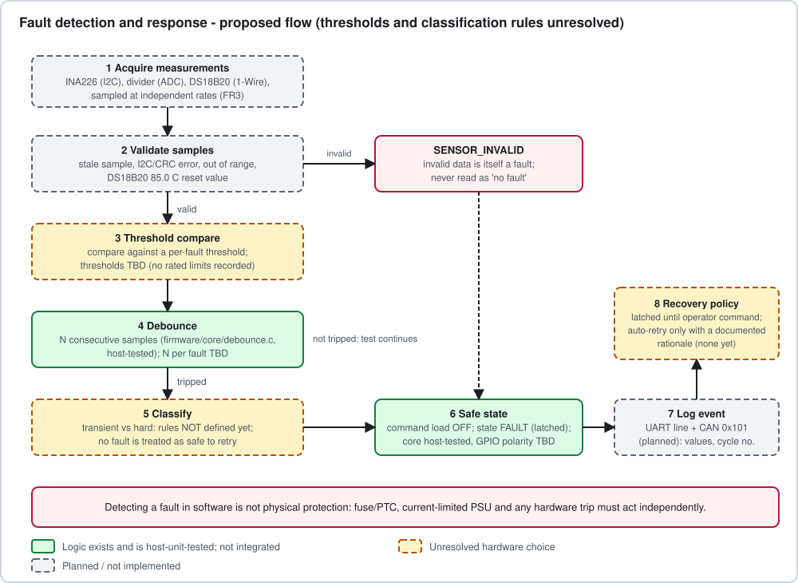

# Fault-diagnostic specification

**Status: specification skeleton. No fault detection is implemented.** What exists in code:
the generic consecutive-sample helper (`firmware/core/debounce.*`) and the latch/clear
behaviour of the state machine (`endurance_raise_fault`/`endurance_clear_fault`), both
host-unit-tested. Every threshold, count and time below is **TBD** because none can be
derived without a chosen switching stage, load ratings and a measured noise floor. They must
not be invented.

> A software fault response is not physical protection. A firmware load-OFF does not protect
> against a short circuit; independent hardware protection is required
> ([hardware_architecture.md](hardware_architecture.md), [safety.md](safety.md)).

## Common rules

1. **Safe state = load commanded OFF** and state `FAULT` (latched). The physical OFF level
   depends on the switch design (OPEN).
2. **Invalid data is not "no fault".** A required measurement that is stale, errored, or out
   of its physical range raises `SENSOR_INVALID` after M consecutive invalid samples (M TBD)
   - applies to I2C errors, DS18B20 CRC/read errors and the DS18B20 85.0 C reset value.
3. **Evidence record** on every fault: fault code, uptime ms, state, cycles completed,
   last valid V/I/T with sample ages and the raw values that tripped the rule.
4. **No automatic re-energizing** after a fault. Recovery requires an authorized operator
   action. Automatic retry may be introduced for a class only with a written rationale that
   the retry cannot re-energize a shorted, overheated or otherwise unsafe load.
5. **Transient vs hard classification is undefined.** Until rules are defined and tested,
   all faults behave as hard (latched).
6. Debounce = N consecutive qualifying samples; any non-qualifying sample resets the count.

## Per-fault specification

| Fault | Detection input | Threshold | Filtering / debounce | Severity (proposed) | Recovery (proposed) | Test case |
|---|---|---|---|---|---|---|
| Overcurrent | INA226 current | TBD (relative to the load/switch rating) | N consecutive samples at the sampling rate (N TBD); an inrush mask after switch-on is probably needed for lamps/motors (length per load TBD) | Critical | Latched; operator clear | Unit: debounce edge cases (**exists** for the helper). HIL/bench: not written |
| Short circuit | INA226 current **plus independent hardware trip** | TBD, far above overcurrent | Software cannot meet a switch's short-circuit withstand time; software only detects and latches after the hardware acts | Critical | Latched; operator clear; inspect wiring first | Bench with current-limited supply and fuse; **not written; do not perform until protection is verified** |
| Open load | INA226 current while commanded ON | Near-zero current threshold TBD (above sensor offset/noise floor) | Must exceed a startup-transient window and noise; timeout TBD | Fault (not hazardous, but invalidates the test) | Latched; retry may be defensible here, not selected | Bench: disconnect load (de-energized first); not written |
| Overtemperature | DS18B20 (switch/heatsink) | TBD from switch and sensor mounting; sensor is **not** junction temperature | Sensor latency up to ~750 ms; thermal lag between junction and sensor must be allowed for | Critical | Latched until below threshold minus hysteresis (hysteresis TBD) **and** operator clear | Unit: hysteresis logic once written; bench: heat source, not written |
| Undervoltage | Supply rail (source of truth OPEN: divider/ADC or INA226 bus V) | TBD | Must separate load-induced sag from a real supply drop (rule TBD) | Fault | Latched or auto-resume on recovery: undecided | Bench with adjustable supply; not written |
| Sensor invalid | Any required measurement | Validity rules above | M consecutive invalid samples (M TBD) | Critical (unknown state) | Latched; operator clear after fixing the sensor | Unit with mocked invalid samples once the validator exists |

## Reaction-time budget

SR4 requires a "bounded reaction time"; none is defined. The budget has to be derived from
(sampling period + debounce count x period + control-tick period + switch turn-off time)
and compared with the switch's and load's tolerance. Measured values go in the
[validation report](validation_report.md); none exist.

## Fault codes

`ENDURANCE_FAULT_*` in `firmware/core/endurance_core.h` is a **provisional** enumeration
(NONE, OVERCURRENT, SHORT_CIRCUIT, OPEN_LOAD, OVERTEMPERATURE, UNDERVOLTAGE, SENSOR_INVALID,
INTERNAL). Do not expose its numeric values on a wire protocol until this policy is final.
