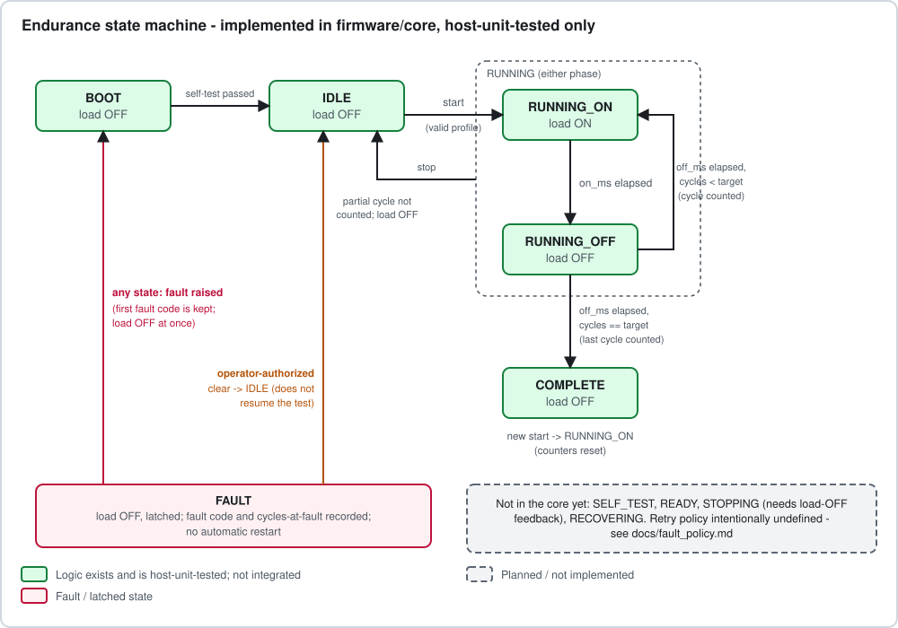
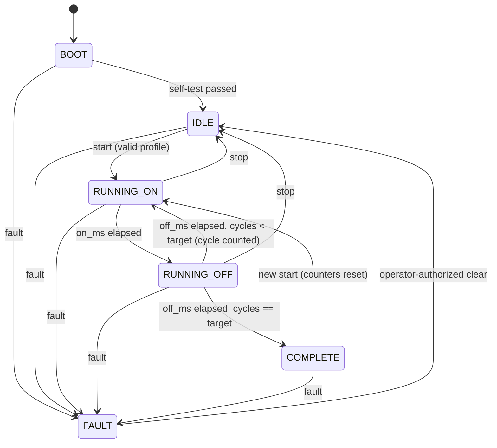

# State Machine

The diagram above is **implemented in `firmware/core/endurance_core.c` and host-unit-tested**
(`tests/unit`). It is not yet part of any firmware image and has never driven a real load.
Editable text version:

## States

| State | Load command | Notes |
|---|---|---|
| BOOT | OFF | Initial state after reset. Waits for the caller to report a passed self-test. No start allowed. |
| IDLE | OFF | Self-test passed, no test running (also the state after stop or fault clear). |
| RUNNING_ON | **ON** | The only state that commands the load ON. |
| RUNNING_OFF | OFF | Off interval; completing it closes the cycle. |
| COMPLETE | OFF | Target reached. A new `start` is allowed and resets counters. |
| FAULT | OFF | Latched. First fault code kept. Time passing never leaves it. |

## Transitions and rules (as implemented)

| Event | From | To | Condition / effect |
|---|---|---|---|
| `self_test_passed` | BOOT | IDLE | Only from BOOT |
| `start(profile, now)` | IDLE, COMPLETE | RUNNING_ON | Profile must validate; counters and stored fault reset; rejected from every other state, **including FAULT** |
| `tick(now)` | RUNNING_ON | RUNNING_OFF | `now - phase_start >= on_ms` (wrap-safe) |
| `tick(now)` | RUNNING_OFF | RUNNING_ON / COMPLETE | `now - phase_start >= off_ms`; `cycles_completed++`; COMPLETE when it reaches `target_cycles` |
| `stop` | RUNNING_* | IDLE | Load OFF immediately; partial cycle **not** counted |
| `raise_fault(code)` | any except FAULT | FAULT | Load OFF; records code and `cycles_completed`; `NONE` is mapped to `INTERNAL` |
| `clear_fault(authorized)` | FAULT | IDLE | Only if `authorized == true`; does **not** resume the interrupted test |

Cycle definition: one ON interval followed by one OFF interval, both fully elapsed. Each
phase lasts *at least* its commanded duration; jitter in the tick adds to the period
rather than shortening a phase.

## Not implemented / open

* `SELF_TEST` and `READY` as separate states: the caller currently reports the self-test
  result; what the self-test checks (sensor presence, safe output level, supply sanity) is
  undefined.
* `STOPPING`: needs a load-OFF confirmation signal (e.g. current ~ 0) that does not exist.
* `RECOVERING` / automatic retry: intentionally absent, see [fault_policy.md](fault_policy.md).
* Resuming a test after reset (needs NVS and a policy on whether a reset is a fault).
* Valid limits for `on_ms`/`off_ms`: 10 ms - 24 h are provisional software bounds only.
